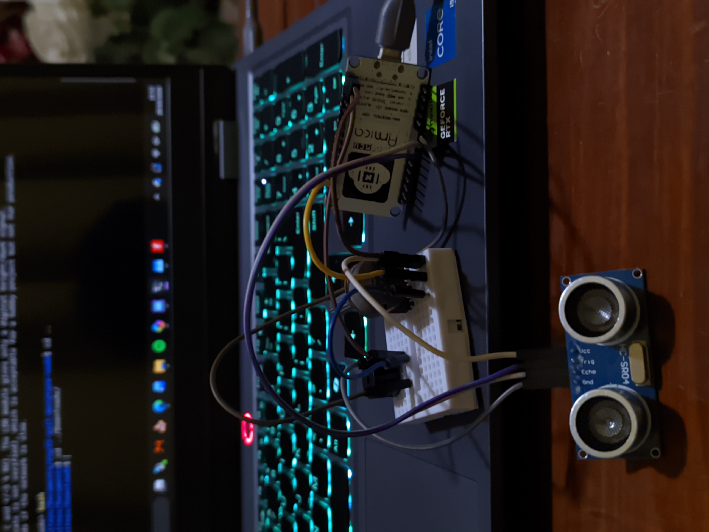
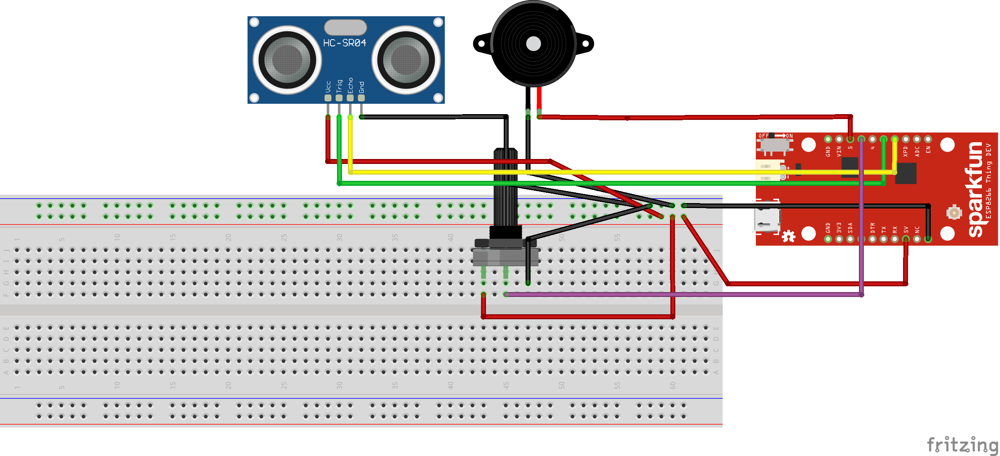

<p align="center">
  
</p>


A configurable proximity alarm built on the **NodeMCU ESP8266**. An HC-SR04 ultrasonic sensor measures distance, a potentiometer sets the alarm threshold in real time, and an active buzzer sounds when an object comes closer than that threshold.

> Basic learning project for sensors, analog input, distance logic, and actuators.


## Features

- Periodic distance measurement with an HC-SR04 ultrasonic sensor
- Alarm threshold adjustable in real time with a 10 kΩ potentiometer
- Active buzzer turns ON/OFF automatically based on distance
- Serial Monitor output showing distance, threshold, and buzzer status

---

## Hardware

| Component | Role |
|---|---|
| NodeMCU ESP8266 | Microcontroller |
| HC-SR04 | Ultrasonic distance sensor |
| Active buzzer | Audible alarm |
| Potentiometer (10 kΩ) | Alarm threshold adjustment |

---
## Wiring


| Part | Pin | Connects to |
|---|---|---|
| HC-SR04 | TRIG | D5 |
| HC-SR04 | ECHO | D6 |
| Active buzzer | + | D7 |
| Active buzzer | - | GND |
| Potentiometer | Middle pin | A0 |
| Potentiometer | Outer pins | 3V3 and GND |

> **Note:** The HC-SR04 ECHO pin outputs 5 V. For long-term use, add a voltage divider or level shifter before connecting it to the ESP8266 GPIO pin.

---

## How It Works

1. The HC-SR04 periodically measures the distance to the nearest object.
2. The potentiometer value is read from analog input `A0`.
3. The analog value is mapped to a distance threshold.
4. If the measured distance is smaller than the threshold, the buzzer turns on.
5. If the object moves farther than the threshold, the buzzer turns off.

Decision logic:

```text
IF distance < threshold:
    buzzer ON
ELSE:
    buzzer OFF
```

The threshold can be changed in real time by turning the potentiometer.

---

## Getting Started

1. Install the **ESP8266 board package** in the Arduino IDE.
2. Select the appropriate **NodeMCU ESP8266** board.
3. Connect the NodeMCU through USB.
4. Open `simple_buzzer_potentiometer.ino` and upload the sketch.
5. Open the Serial Monitor to view the readings.

You can also see the demo video [here](docs/demo.mp4)


